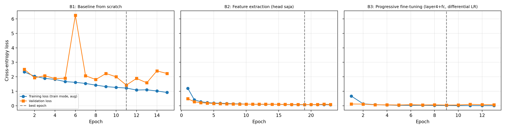
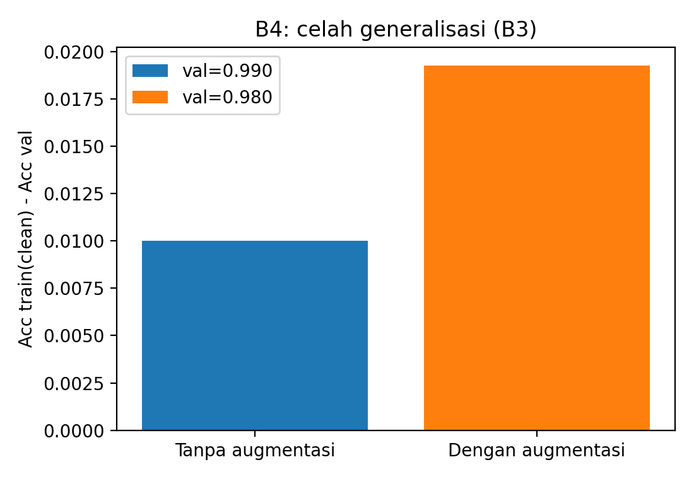
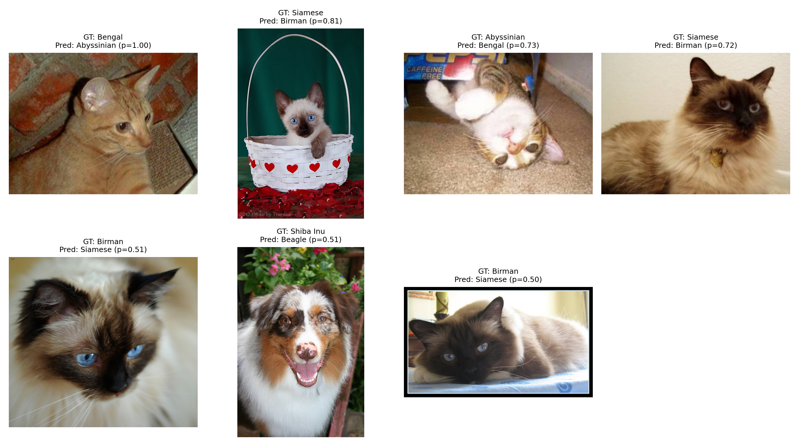
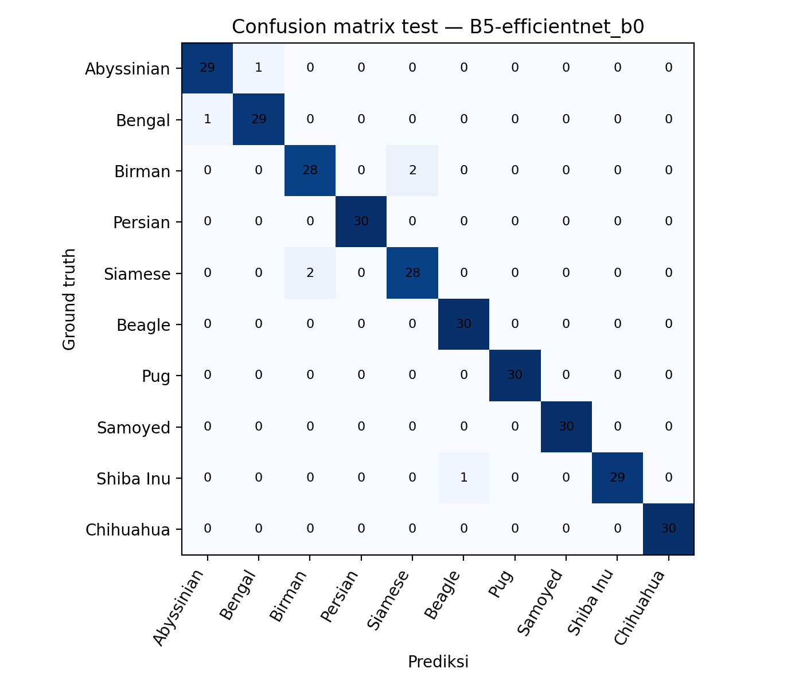
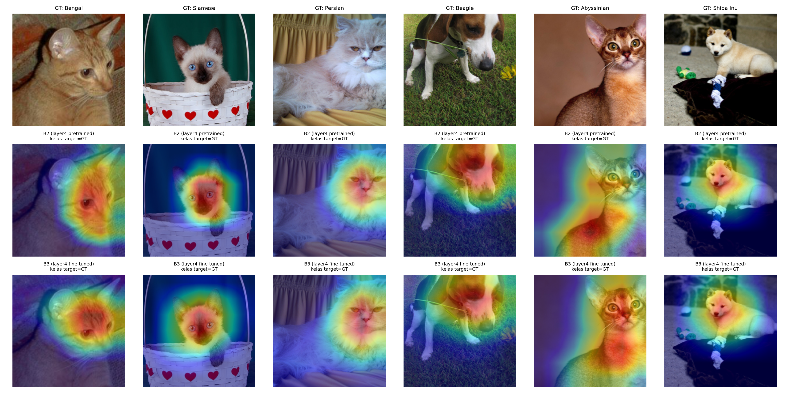

# Laporan GSLC Sesi 5: Transfer Learning untuk Klasifikasi Citra dengan Data Terbatas

Nama: Samuel Rafin Djunaidi
NIM: 2802477383
Tugas: GSLC Sesi 5, Advanced CNNs and Transfer Learning
Dataset: Oxford-IIIT Pet, subset 10 kelas, seed 42

Semua angka di laporan ini diambil dari `outputs/results/raw_metrics.json` (isi yang sama ada di `raw_metrics.csv` dan `tabel_konsolidasi.md`), log per epoch `outputs/logs/*_history.csv`, dan prediksi test `outputs/logs/*_test_predictions.csv`. Angka desimal ditulis dengan koma: 0,9532 di sini sama dengan 0.9532 di berkas log.

Bagian A dikumpulkan terpisah sebagai `jawaban_bagian_A.md` dan versi PDF-nya.

---

## Bagian C: Laporan dan Analisis

### 1. Setup Eksperimen

Subset yang dipakai berisi lima ras kucing (Abyssinian, Bengal, Birman, Persian, Siamese) dan lima ras anjing (Beagle, Pug, Samoyed, Shiba Inu, Chihuahua). Split `trainval` dan `test` bawaan torchvision digabung lebih dulu, totalnya 1.997 citra: delapan kelas punya 200 citra, Abyssinian 198, Siamese 199. Dari situ kumpulan dibagi ulang secara stratified dengan dua kali `train_test_split` (`random_state=42`) menjadi 1.397 citra train, 300 val, dan 300 test. Setiap kelas mendapat tepat 30 citra val dan 30 citra test, sedangkan jatah train-nya 138 sampai 140. Pembagian dikerjakan pada array indeks sebelum transformasi apa pun dipasang, dan notebook memastikan lewat `assert` bahwa ketiga himpunan indeks saling lepas. Daftar file tiap split tersimpan di `outputs/results/split_indices.json`.

Protokolnya mengikuti Bagian 4.2 soal. Model utama adalah ResNet-18 dengan bobot `IMAGENET1K_V1`, kecuali B1 yang memakai `weights=None`. Input berukuran 224×224 dengan normalisasi mean dan std ImageNet. Optimizer AdamW (weight decay 1e-2), batch size 32, dan CrossEntropyLoss dipakai di semua kondisi. Early stopping memantau validation loss dengan patience 4, `min_delta` 1e-4, dan batas 30 epoch, lalu bobot dengan val loss terendah dikembalikan sebelum evaluasi. Seed 42 dipasang untuk `random`, NumPy, PyTorch (termasuk CUDA), `cudnn.deterministic`, dan generator DataLoader, lalu dipasang ulang di awal setiap eksperimen. Augmentasi hanya untuk train: Resize(256), RandomResizedCrop(224, scale 0,8 sampai 1,0), RandomHorizontalFlip(0,5), RandomRotation(15°), dan ColorJitter(brightness 0,2, contrast 0,2). Val dan test selalu memakai eval transform deterministik dari `ResNet18_Weights` (Resize 256, CenterCrop 224, Normalize).

Ada satu keputusan implementasi yang berbeda dari starter code: lapisan BatchNorm yang dibekukan dipaksa ke mode `eval()` selama training. `requires_grad=False` hanya menghentikan pembaruan gamma dan beta. Running mean dan running variance tetap ikut diperbarui kalau model berada di mode `train()`, sehingga backbone yang katanya beku di B2 sebenarnya pelan-pelan bergeser mengikuti statistik batch berisi 32 citra hewan. Dengan pemaksaan ini B2 benar-benar memakai statistik ImageNet, dan di B3, B4, serta B5 hanya BN di dalam blok yang dibuka yang menyesuaikan diri. Angka B2 dan B3 ikut ditentukan oleh pilihan tersebut.

Celah generalisasi (gap train-val) dihitung sebagai akurasi train dikurangi akurasi val. Akurasi train di sini diukur ulang dengan eval transform pada bobot terbaik ("clean"). Besaran itu tidak bisa dibandingkan langsung dengan training loss di kurva, yang dicatat dalam mode train dengan augmentasi aktif.

Semua eksperimen dijalankan di Google Colab dengan GPU Tesla T4, Python 3.13.15, torch 2.11.0+cu130, torchvision 0.26.0+cu130, dan `num_workers=2` (`outputs/results/environment.json`). Total waktu training kelima run 1.177,9 detik, kira-kira 19,6 menit.

### 2. C1: Tabel Konsolidasi dan Kurva Belajar

Tabel 1. Ringkasan B1 sampai B5. Epoch konvergen adalah epoch dengan val loss terendah, diikuti jumlah epoch yang benar-benar dijalankan sampai early stopping berhenti. Waktu latih adalah wall-clock di T4, sudah termasuk validasi tiap epoch.

| Kode | Strategi | Trainable params / total | LR per grup | Epoch konvergen / dijalankan | Waktu latih, s (s/epoch) | Acc val | Acc test | Macro F1 test | Gap train-val |
|---|---|---|---|---|---|---|---|---|---|
| B1 | ResNet-18 from scratch, aug | 11.181.642 / 11.181.642 | semua 1e-3 | 11 / 15 | 230,1 (15,34) | 0,5200 | 0,5200 | 0,5045 | 0,0949 |
| B2 | Feature extraction, hanya fc, aug | 5.130 / 11.181.642 | fc 1e-3 | 19 / 23 | 320,5 (13,93) | 0,9700 | 0,9700 | 0,9699 | 0,0143 |
| B3 | Fine-tuning layer4 + fc, aug | 8.398.858 / 11.181.642 | layer4 1e-4; fc 1e-3 | 9 / 13 | 184,4 (14,19) | 0,9800 | 0,9533 | 0,9532 | 0,0193 |
| B4-1 | B3 tanpa augmentasi | 8.398.858 / 11.181.642 | layer4 1e-4; fc 1e-3 | 19 / 23 | 229,1 (9,96) | 0,9900 | 0,9600 | 0,9599 | 0,0100 |
| B4-2 | B3 dengan augmentasi (= run B3) | 8.398.858 / 11.181.642 | layer4 1e-4; fc 1e-3 | 9 / 13 | 184,4 (14,19) | 0,9800 | 0,9533 | 0,9532 | 0,0193 |
| B5 | EfficientNet-B0, fine-tuning features[7], features[8] + classifier, aug | 1.142.202 / 4.020.358 | blok akhir 1e-4; head 1e-3 | 11 / 15 | 213,8 (14,26) | 0,9967 | 0,9767 | 0,9767 | 0,0005 |

Baris B4-2 bukan run terpisah: kondisi dasar untuk B4 adalah B3. Skenario tanpa augmentasi (B4-1) dilatih sendiri dengan log `B4-1_history.csv` dan `B4-1_test_predictions.csv`. Skenario dengan augmentasi persis sama dengan B3: mode fine-tuning, augmentasi, split, optimizer, learning rate, patience, dan seed 42 yang dipasang ulang di awal run. Menjalankan ulang B3 hanya akan menghasilkan run yang identik, paling banter berbeda sedikit karena non-determinisme GPU (`torch.use_deterministic_algorithms` tidak diaktifkan). Notebook karena itu menyalin hasil B3 ke B4-2, dan bukti mentah B4-2 adalah `B3_history.csv` dan `B3_test_predictions.csv`. Pasangan B3 dan B4-1 pun menjadi perbandingan satu faktor: yang berbeda hanya transformasi data train.

Gambar 1. Training loss (mode train, dengan augmentasi) dan validation loss per epoch untuk B1, B2, dan B3. Garis putus-putus menandai epoch terbaik.

Ketiga panel memakai sumbu y yang sama, sehingga kurva B2 dan B3 terlihat tertekan di dekat nol oleh skala B1 yang sampai 6,25. Val loss B2 turun hampir monoton dari 0,491 di epoch 1 ke 0,083 di epoch 19. Val loss B3 sudah 0,125 di epoch 1, mencapai 0,052 di epoch 9, lalu naik lagi ke 0,101 di epoch 11, sementara training loss-nya terus turun sampai 0,008 di epoch 13.

### 3. C2: Analisis Komparatif

#### 3.1 Mengapa B1 tertinggal jauh dari B2 dan B3 (Slide 10–12, 16)

Jaraknya besar. B1 berhenti di Macro F1 test 0,5045, sedangkan B2 mencapai 0,9699 dan B3 0,9532. Dari 300 citra test, B1 salah 144, B2 salah 9, dan B3 salah 14. Sejak epoch pertama pun sudah terpisah: val accuracy B2 0,92 dan B3 0,957, sementara B1 masih 0,20.

Masalah B1 bukan optimasi. ResNet-18 sudah punya residual connection dan BatchNorm, yang menurut Slide 10–12 membuat jaringan dalam bisa dilatih, dan training loss B1 memang turun stabil dari 2,33 ke 0,92 dalam 15 epoch. Masalahnya ada di data. Sebelas juta parameter harus belajar dari nol, mulai dari detektor tepi sampai pola bulu, hanya dari 1.397 citra atau sekitar 140 per kelas. Backbone pretrained sudah membawa hierarki fitur itu dari 1,28 juta citra ImageNet, sehingga di B2 cukup 5.130 bobot head yang perlu dicari. Inilah alasan transfer learning di Slide 16: fitur umum dipinjam, yang dilatih hanya bagian yang spesifik.

Kurva B1 lebih cocok dibaca sebagai kombinasi underfitting dan generalisasi yang buruk, bukan overfitting klasik. Akurasi train clean-nya baru 0,6149; data latihnya sendiri belum dikuasai. Val loss-nya pun tidak pernah turun dengan rapi: naik turun antara 1,43 dan 2,51, dengan lonjakan ke 6,245 di epoch 6 (val accuracy jatuh ke 0,183). Lonjakan seperti itu wajar untuk model acak yang BN-nya masih belajar running statistics dari batch kecil, karena statistik yang belum stabil membuat mode eval berperilaku cukup berbeda dari mode train. Pola kesalahannya menunjukkan fitur yang belum terbentuk: 44 dari 144 kesalahan B1 menyeberang spesies (kucing ditebak anjing atau sebaliknya), misalnya Beagle menjadi Chihuahua 7 kali. Model pretrained hampir tidak pernah salah seperti itu: B2 hanya sekali, sedangkan B3, B4-1, dan B5 tidak pernah. Val accuracy dan test accuracy B1 kebetulan sama-sama 0,5200, dan angka test-nya sudah dicocokkan ulang dari berkas prediksi.

#### 3.2 Trade-off performa dan stabilitas: feature extraction vs fine-tuning (Slide 16, 28)

Di validation set, fine-tuning sedikit unggul. B3 mencapai val accuracy 0,9800 dan val loss 0,052, dibanding B2 dengan 0,9700 dan 0,083, dan B3 juga konvergen lebih cepat, di epoch 9 dibanding epoch 19. Di test set urutannya berbalik: Macro F1 B2 0,9699 dan B3 0,9532, atau 9 lawan 14 kesalahan. Satu citra test setara 0,33 poin persentase. Selisih itu berarti lima citra, dari satu seed. Pada data sebesar ini, membuka 8,4 juta parameter tambahan tidak memberi keuntungan yang konsisten dibanding melatih 5.130 parameter saja.

Dari sisi biaya selisihnya kecil. Waktu per epoch B2 13,93 detik dan B3 14,19 detik, padahal jumlah parameter yang dilatih berbeda lebih dari seribu kali. Bottleneck-nya ada di pipeline augmentasi di CPU, bukan di backward pass. Buktinya ada di B4-1: tanpa augmentasi, run yang sama turun ke 9,96 detik per epoch. Total waktu B2 malah paling lama (320,5 detik) karena early stopping baru berhenti di epoch 23.

Perbedaan yang paling jelas ada di stabilitas. Kurva val loss B2 mulus dan berimpit dengan training loss, bahkan sering sedikit di bawahnya karena training loss diukur di bawah augmentasi. Kurva B3 lebih berisik setelah epoch 5. Val loss-nya berganti-ganti 0,056, 0,075, 0,060, 0,066, 0,052, lalu melonjak ke 0,101 di epoch 11, dan val accuracy-nya bergerak antara 0,957 dan 0,983. Pada saat yang sama akurasi train clean B3 mencapai 0,9993. Model sudah hampir menghafal data latih, dan early stopping-lah yang menahan kerusakan lebih lanjut.

Dalam istilah Slide 28, gejala ini lebih mirip overfitting di blok atas daripada catastrophic forgetting. Seandainya fitur ImageNet rusak, performa akan anjlok di semua kelas, padahal B3 tidak membuat satu pun kesalahan lintas spesies. Kesalahannya terkumpul di pasangan ras yang memang mirip: Siamese ke Birman 5 kali, Abyssinian ke Bengal 3 kali, Bengal ke Abyssinian 2 kali. Grad-CAM di bagian C5 juga menunjukkan fokus B3 tetap di tubuh hewan. Learning rate 1e-4 untuk layer4 kemungkinan besar yang menjaga pergeseran tetap kecil. Yang perlu diwaspadai, B3 lebih yakin pada kesalahannya: citra test 137 diprediksi Abyssinian dengan confidence 1,000 oleh B3 dan 0,986 oleh B2.

#### 3.3 Peran augmentasi dalam meredam overfitting (B4, Slide 20)

Hasil B4 tidak sesuai harapan umum. Tanpa augmentasi (B4-1), gap train-val 0,0100 dengan val accuracy 0,9900 dan Macro F1 test 0,9599. Dengan augmentasi (B4-2, yaitu B3), gap-nya 0,0193 dengan val accuracy 0,9800 dan Macro F1 test 0,9532. Pada run ini augmentasi tidak memperkecil gap akurasi dan tidak memperbaiki akurasi val maupun test. Selisihnya tiga citra val (3 lawan 6 salah) dan dua citra test (12 lawan 14 salah), terlalu kecil untuk ditafsirkan sebagai efek nyata dengan satu seed.

Gambar 2. Gap akurasi train (clean) dikurangi akurasi val untuk B3 tanpa augmentasi (B4-1) dan dengan augmentasi (B4-2 = B3).

Metrik gap berbasis akurasi juga kurang peka di sini karena sudah jenuh. Kedua skenario memiliki akurasi train di atas 0,999, sehingga gap hanya mencerminkan beberapa citra val yang salah. Log loss lebih informatif. Tanpa augmentasi, akurasi train sudah 1,000 di epoch 5 dan setelahnya tidak pernah di bawah 0,999; pada epoch terbaik (19) training loss tinggal 0,0005 sementara val loss 0,0366. Rasio sekitar 70 kali itu adalah tanda memorisasi yang tidak tampak di akurasi. Dengan augmentasi, training loss pada epoch terbaik (9) masih 0,023. Model tidak bisa menghafal citra yang terus berubah, tetapi early stopping juga berhenti lebih awal, di epoch 13 dibanding 23.

Penjelasan yang paling masuk akal: tugasnya relatif mudah bagi backbone pretrained. Fitur ImageNet sudah cukup invarian terhadap flip, rotasi kecil, dan perubahan kecerahan, sehingga augmentasi ringan tidak menambah banyak informasi baru bagi layer4, dan ruang untuk overfitting pun sempit. Biayanya tetap nyata, sekitar 4,2 detik per epoch atau 42 persen lebih lambat di setup ini. Dari data ini, klaim bahwa augmentasi mengurangi overfitting tidak bisa didukung. Yang bisa dikatakan hanya bahwa augmentasi menahan training loss tetap jauh dari nol, tanpa efek terukur pada akurasi.

#### 3.4 B5: EfficientNet-B0 (bonus, Slide 24)

B5 memakai konfigurasi B3 (fine-tuning blok akhir dengan differential learning rate dan augmentasi) pada EfficientNet-B0. Hasilnya terbaik di semua metrik: val accuracy 0,9967, Macro F1 test 0,9767 (7 kesalahan), dan gap hanya 0,0005. Jumlah parameternya 4.020.358, sekitar 36 persen dari ResNet-18, dan parameter yang dilatih 1.142.202 dibanding 8.398.858 di B3. Waktu per epoch-nya sama saja (14,26 detik vs 14,19 detik) karena bottleneck CPU tadi; keunggulan efisiensinya ada di ukuran model, bukan di waktu training yang terukur di sini. Selisih terhadap B2 hanya dua citra test, maka B5 sebaiknya dibaca sebagai "setara atau sedikit lebih baik dengan model jauh lebih kecil".

### 4. C3: Failure Analysis

Model terbaik dipilih berdasarkan val accuracy, yaitu B5 (EfficientNet-B0, 0,9967), tanpa melihat test set. B5 salah pada 7 dari 300 citra test, dan ketujuhnya ditampilkan, diurutkan dari confidence tertinggi. Tidak ada sampel yang dipilih-pilih.

Gambar 3. Tujuh citra test yang salah diprediksi B5, dengan label asli, prediksi, dan confidence.

| # | test_idx | Ground truth | Prediksi (confidence) | Hipotesis penyebab |
|---|---|---|---|---|
| 1 | 137 | Bengal | Abyssinian (0,998) | Kucing oranye polos tanpa rosette atau bintik yang menjadi ciri Bengal. Bulunya seragam kemerahan, justru ciri Abyssinian. Semua model ResNet (B1 sampai B4-1) juga menebak Abyssinian, jadi kemungkinan besar ini sampel atipikal atau label noise, bukan kelemahan B5. |
| 2 | 977 | Siamese | Birman (0,813) | Anak kucing di keranjang. Colorpoint pada kitten belum tegas dan bulunya masih halus mengembang, sehingga tampak semi-panjang seperti Birman. Latar ramai (keranjang, motif hati merah, kelopak bunga) ikut mengisi frame. B2, B3, dan B4-1 benar pada citra ini, tetapi dengan confidence rendah (0,555 sampai 0,621). |
| 3 | 1009 | Abyssinian | Bengal (0,727) | Pose ekstrem: kucing telentang dengan wajah terbalik sekitar 180°, jauh di luar rentang RandomRotation 15°. Perut putih dan corak tabby yang terlihat lebih mirip pola Bengal daripada bulu ticked Abyssinian. |
| 4 | 1916 | Siamese | Birman (0,724) | Kucing colorpoint dengan bulu tebal dan mengembang, mirip tipe Birman. Kaki, tempat sarung putih khas Birman (atau ketiadaannya), tidak terlihat. B4-1 juga menebak Birman dengan 0,996, jadi ambiguitas visual ini nyata. |
| 5 | 1343 | Birman | Siamese (0,511) | Close-up wajah yang sangat dekat. Yang terlihat hanya masker wajah gelap dan mata biru, padahal keduanya dimiliki Siamese dan Birman. Panjang bulu tubuh dan kaki putih terpotong dari frame. Confidence hampir 50:50. |
| 6 | 907 | Shiba Inu | Beagle (0,507) | Anjing di citra tampak seperti anjing gembala berbulu merle tiga warna (putih, cokelat, abu-abu), bukan Shiba Inu pada umumnya. Ini kemungkinan label noise di dataset. Bulu tiga warna menjelaskan tebakan Beagle, dan model lain juga tidak sepakat (B2 benar dengan 0,637, B3 menebak Samoyed, B4-1 menebak Beagle). |
| 7 | 1387 | Birman | Siamese (0,499) | Kucing berbaring dengan kaki terlipat sehingga ciri kaki putih tidak terlihat. Wajahnya gelap dan citra memiliki bingkai hitam tebal, artefak yang kemungkinan jarang muncul di data latih. |

Gambar 4. Confusion matrix B5 pada test set.

Kesalahan B5 hanya muncul di tiga pasangan: Birman dan Siamese (2 ke masing-masing arah), Abyssinian dan Bengal (1 ke masing-masing arah), serta satu Shiba Inu yang ditebak Beagle. Persian, Beagle, Pug, Samoyed, dan Chihuahua benar 30 dari 30. Pasangan Siamese dan Birman juga yang paling sering tertukar di B3 dan B4-1 (Siamese ke Birman 5 kali), dan bahkan di B1 (14 dan 11 kali). Kedua ras ini sama-sama colorpoint bermata biru, sedangkan pembedanya, yaitu panjang bulu dan kaki putih Birman, sering tidak tampak karena pose atau crop. Sebagian besar kesalahan karena itu bukan soal model yang kurang belajar, melainkan informasi pembedanya tidak ada di citra. Tiga dari tujuh kesalahan punya confidence sekitar 0,50, sehingga ambang penolakan sederhana (misalnya meminta tinjauan manusia jika confidence di bawah 0,6) akan menangkap hampir separuh kesalahan. Pengecualiannya sampel 1, yang salah dengan sangat yakin.

### 5. C4: Rekomendasi Rekayasa dan Batasan

Kondisi di sini cukup khas: sekitar 140 citra berlabel per kelas, domain foto natural yang dekat dengan ImageNet, dan satu GPU kelas T4.

Mulai dari feature extraction (B2) sebagai baseline. Konfigurasi ini hanya melatih 5.130 parameter, kurvanya paling stabil, dan Macro F1 test-nya 0,9699, hanya dua citra di bawah model terbaik. Risiko merusak backbone hampir tidak ada, dan untuk banyak tugas klasifikasi produk atau inspeksi visual dengan data sedikit, hasil seperti ini sudah cukup. Untuk deployment, pilih EfficientNet-B0 dengan fine-tuning blok terakhir dan differential learning rate (B5): Macro F1 0,9767 dengan 36 persen parameter ResNet-18, yang penting kalau model harus berjalan di perangkat dengan memori terbatas. Fine-tuning ResNet-18 layer4 (B3) tidak memberi keuntungan di test set dan kurva val-nya lebih berisik, jadi baru layak dicoba bila feature extraction jelas underfitting.

Rekomendasi ini punya syarat berlaku. Kalau domain jauh dari ImageNet, misalnya citra medis, satelit, atau termal, fitur beku kemungkinan tidak cukup dan lebih banyak blok perlu dibuka dengan learning rate kecil. Kalau data per kelas jauh lebih sedikit dari 100, feature extraction lebih aman daripada fine-tuning. Kalau training harus cepat, ukur dulu pipeline datanya: di setup ini augmentasi di CPU menambah 42 persen waktu per epoch, dan menambah `num_workers` atau memindahkan augmentasi ke GPU kemungkinan lebih berpengaruh daripada mengganti arsitektur. Gunakan juga confidence sebagai sinyal operasional, dengan prediksi berconfidence rendah diarahkan ke peninjauan manusia. Dua citra yang tampaknya salah label (137 dan 907) juga mengingatkan bahwa membersihkan label bisa sama bernilainya dengan menyetel model.

Batasan studi ini perlu disebut terus terang:

- Semua hasil berasal dari satu seed (42). Dengan 300 citra test, satu citra setara 0,33 poin persentase, dan selisih antara B2, B3, B4-1, dan B5 hanya 2 sampai 7 citra. Urutan model bisa berubah dengan seed lain. Ranking val dan test pun sudah tidak sejalan: B3 dan B4-1 lebih baik dari B2 di val tetapi lebih buruk di test.
- Hanya 10 kelas dari dua spesies. Sebagian besar kelas mudah dipisahkan, sehingga akurasi mendekati jenuh dan metrik gap kurang sensitif.
- B4-2 tidak dilatih ulang tetapi memakai run B3 karena konfigurasinya identik. Log-nya adalah log B3.
- B5 memakai augmentasi, padahal B4-1 (tanpa augmentasi) memiliki val loss lebih rendah (0,0366 vs 0,0516). B5 juga memakai eval transform ResNet, bukan transform bawaan EfficientNet, agar preprocessing seragam antar model.
- Hyperparameter tidak di-tune: learning rate tetap, tanpa scheduler, warmup, atau gradual unfreezing.
- BN yang dibekukan dipaksa ke mode eval. Angka B2 dan B3 bisa berbeda jika memakai `model.train()` biasa seperti starter code.
- Latensi inferensi dan FLOPs tidak diukur, jadi klaim efisiensi B5 terbatas pada jumlah parameter. `use_deterministic_algorithms` tidak diaktifkan, sehingga reproduksi bit-per-bit di GPU tidak dijamin.
- Anggaran komputasi terbatas pada Colab T4 gratis, sehingga tidak ada pengulangan run atau eksperimen arsitektur tambahan.

### 6. C5: Grad-CAM Sebelum dan Sesudah Fine-Tuning (Slide 29)

Grad-CAM (Selvaraju dkk., 2017) diambil dari keluaran `layer4` dengan kelas target sama dengan ground truth. Kondisi "sebelum" memakai checkpoint B2; karena layer4 B2 dibekukan, bobotnya masih bobot ImageNet asli dan yang dilatih hanya head untuk 10 kelas. Kondisi "sesudah" memakai checkpoint B3, yang layer4-nya di-fine-tune. Enam citra test ditampilkan. Dua yang pertama (137 Bengal dan 977 Siamese) adalah kesalahan teratas B5, dan empat sisanya diprediksi benar oleh B2 dan B3.

Gambar 5. Baris atas: citra input. Baris tengah: Grad-CAM B2 (layer4 pretrained). Baris bawah: Grad-CAM B3 (layer4 fine-tuned).

Sebelum maupun sesudah fine-tuning, aktivasi sudah berada di tubuh hewan, terutama kepala, bukan di latar seperti rumput, tirai, atau keranjang. Ini tidak mengejutkan karena ImageNet sendiri berisi banyak kelas kucing dan anjing. Pergeserannya ada, tetapi sedang. Pada Bengal, peta B2 terpusat di pipi dan sekitar mata, sedangkan peta B3 lebih padat di tengah wajah. Peta Abyssinian B2 memanjang dari leher ke dada dengan puncak di dada bawah, sementara B3 lebih terpusat di wajah dan dada atas. Untuk Persian, peta B3 meluas dari wajah ke bulu dada. B3 pada Beagle mencakup lebih banyak area telinga dan kepala, dan pada Shiba Inu menyebar ke kepala serta sebagian tubuh. Anak kucing Siamese hampir tidak berubah: keduanya fokus di wajah, dengan B3 sedikit lebih lebar ke arah telinga.

Kecenderungannya, setelah fine-tuning layer4 memberi bobot lebih pada area yang relevan untuk membedakan ras, seperti masker wajah, telinga, dan tekstur bulu, dan sedikit mengurangi fokus di area yang kebetulan. Pergeseran yang moderat ini sesuai dengan praktik di Slide 29: learning rate kecil (1e-4) selama 9 epoch menyesuaikan representasi tanpa membuangnya. Citra 137 mengingatkan bahwa fokus yang tepat tidak menjamin prediksi benar. Peta B3 untuk kelas Bengal terpusat rapi di wajah kucing itu, tetapi B3 tetap menebak Abyssinian dengan confidence 1,000, mungkin karena di area tersebut memang tidak ada pola khas Bengal. Analisis ini kualitatif dan hanya berdasarkan enam citra, belum cukup untuk klaim umum tentang perubahan representasi.

### 7. Referensi

- Parkhi, O. M., Vedaldi, A., Zisserman, A., & Jawahar, C. V. (2012). Cats and Dogs. CVPR.
- Selvaraju, R. R., Cogswell, M., Das, A., Vedantam, R., Parikh, D., & Batra, D. (2017). Grad-CAM: Visual Explanations from Deep Networks via Gradient-based Localization. ICCV.
- Tan, M., & Le, Q. V. (2019). EfficientNet: Rethinking Model Scaling for Convolutional Neural Networks. ICML.
- Bahan tayang Sesi 05, Advanced CNNs and Transfer Learning (Slide 5 sampai 30).
- Dokumentasi PyTorch dan torchvision (model `resnet18`, `efficientnet_b0`, dataset `OxfordIIITPet`).

---

## Lampiran: Pernyataan Penggunaan AI (AI Disclosure Statement)

Alat AI yang digunakan:

- Claude (Anthropic), lewat antarmuka chat.
- Kiro, asisten AI di IDE yang berjalan di atas model Claude.

Ruang lingkup bantuan AI:

- Claude menulis kode notebook `Tugas05_Notebook.ipynb`, meliputi pemuatan dan split data, pipeline transformasi, training loop dengan early stopping, pencatatan metrik, failure analysis, dan Grad-CAM. Claude juga membuat draf pertama jawaban Bagian A, template laporan Bagian C, `README.md`, dan `requirements.txt`.
- Kiro memeriksa berkas-berkas tersebut terhadap soal (protokol Bagian 4, komponen C1 sampai C5, dan ketentuan pengumpulan). Kiro mengaudit notebook dan log hasil eksekusi, termasuk menemukan bahwa B4-2 adalah salinan run B3. Kiro merevisi jawaban Bagian A, menyusun draf laporan ini dari log hasil Colab (tabel, analisis, hipotesis failure analysis, dan pembacaan Grad-CAM), lalu merapikan berkas untuk pengumpulan.
- Saya sendiri menjalankan notebook end-to-end di Google Colab dengan GPU T4 dan menyerahkan seluruh keluarannya (log CSV, `raw_metrics.json`, gambar). Semua angka di laporan berasal dari run tersebut.

Bagian yang saya periksa sendiri:

Saya membaca notebook sel per sel sebelum menjalankannya, dengan perhatian khusus pada tiga bagian yang paling menentukan validitas perbandingan: pembagian data pada level indeks sebelum transformasi dipasang, pengaturan requires_grad beserta pemaksaan BatchNorm ke mode eval(), dan penyusunan param group pada AdamW untuk differential learning rate. Setelah temuan soal B4-2 diangkat, saya mencocokkannya sendiri dengan log: berkas `B4-2_history.csv` memang tidak ada, dan entri B4-2 pada `raw_metrics.json` identik dengan B3 kecuali kode dan namanya. Dari situ saya memutuskan fakta tersebut harus dinyatakan terbuka di Tabel 1 dan di bagian batasan, bukan dibiarkan tampil sebagai baris tabel biasa.

Cara verifikasi keluaran AI:

Verifikasi saya lakukan berlapis. Pertama, setiap angka pada Tabel 1 dan tabel failure analysis saya cocokkan satu per satu dengan `outputs/results/raw_metrics.json` dan `outputs/logs/*_history.csv`. Kedua, agar Macro F1 tidak hanya bersandar pada angka yang dicetak notebook, saya hitung ulang accuracy dan Macro F1 dari `outputs/logs/*_test_predictions.csv` memakai scikit-learn di sesi terpisah, dan hasilnya sama sampai empat desimal. Ketiga, klaim 5.130 trainable parameter pada B2 dan 8.398.858 pada B3 saya periksa dari luaran sel notebook, bukan dari narasi AI. Keempat, untuk Bagian A saya buka kembali abstrak paper yang disitasi, dan beberapa rujukan pada draf awal saya hapus karena tidak dapat saya konfirmasi keberadaannya. Kelima, hipotesis pada failure analysis saya susun setelah melihat sendiri ketujuh citra pada `outputs/figures/failure_analysis.png`, sehingga alasan seperti kaki tersembunyi atau pose terbalik memang sesuai dengan citranya.
